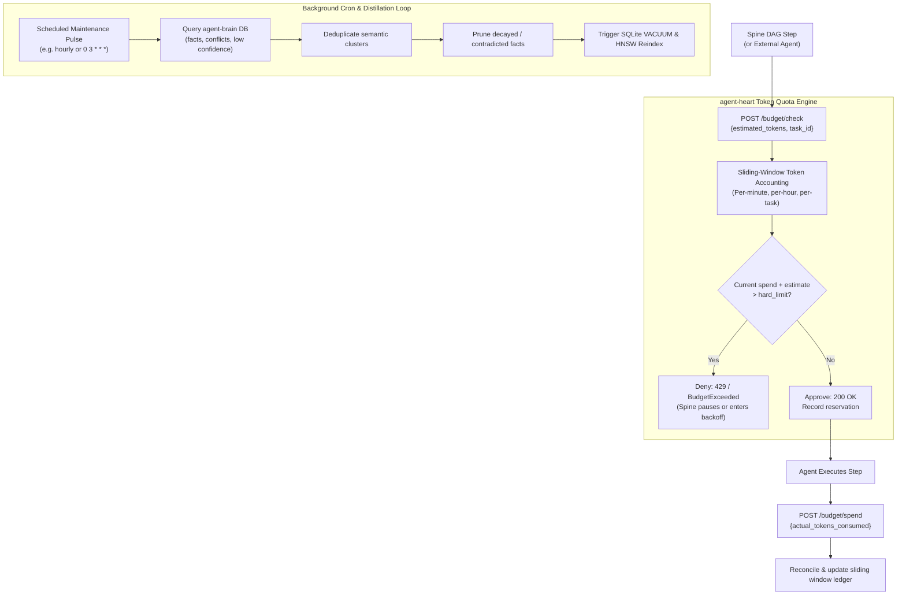

# agent-heart — Deep Operational & Architectural Context for Agents

> **Controller Manager, Token Budget Gate & Memory GC** — In-depth architectural guide, token accounting mechanics, background maintenance scheduler, CLI matrix, HTTP/MCP contracts, and failure recovery runbooks for `agent-heart`.  
> **Ecosystem Version Baseline:** `v1.0.0-beta.3`  
> **Documentation Hub:** [https://autonomic-ai.dev/docs/maintenance](https://autonomic-ai.dev/docs/maintenance) · [Architecture Hub](https://autonomic-ai.dev/docs/architecture)  
> **Port:** HTTP API `:3101`  
> **Default Workspace & State:** `~/.autonomic/heart/` · `~/.autonomic/state/heart/`

---

## 1. Executive Summary & Biological Role

In the Autonomic 11-organ architecture, **`agent-heart`** serves as the **Controller Manager, Resource Quota Enforcer, and Homeostatic Regulator** (analogous to Kubernetes Controller Manager, ResourceQuota, and Background Garbage Collector).

Left unconstrained, autonomous coding agents suffer from two destructive economic and cognitive failures:
1. **Unbounded Token Burn:** When an agent encounters an edge-case bug, it frequently enters unmonitored retry loops, consuming millions of tokens and racking up substantial API bills before a human notices.
2. **Memory Decay & Fragmentation:** Over time, thousands of ad-hoc prompt turns accumulate duplicate, conflicting, and obsolete facts in vector memory (`brain.db`), degrading retrieval recall.

`agent-heart` solves these challenges by providing continuous, background homeostatic regulation:
- **Token Budget Gatekeeper:** Enforces sliding-window token accounting across tasks, models, and sessions. Pre-flights costly DAG execution steps in `agent-spine` with strict budget checks.
- **Background Memory GC & Distillation:** Runs scheduled maintenance cycles against `agent-brain`, pruning obsolete memories, consolidating duplicate facts, and optimizing SQLite database indexes.

---

## 2. Core Architecture & Regulatory Mechanics



### 2.1 Sliding-Window Token Accounting & PID Throttling
`agent-heart` tracks token consumption across multiple dimensions:
- **Task Session Bounding:** Sets a strict maximum token ceiling (e.g. 100,000 tokens) for a given mission. If reached, all non-essential LLM generation is blocked.
- **Velocity Detection & Backpressure:** Monitors token burn rate per minute. When anomalous consumption spikes occur (e.g. tight retry loops), `agent-heart` throttles downstream requests, enforcing exponential delays before allowing new model invocations.

### 2.2 Memory Garbage Collection & Distillation
Running directly inside an agent's active typing loop to clean memory causes unacceptable latency. `agent-heart` offloads this maintenance to an asynchronous background daemon:
- **Semantic Deduplication:** Identifies near-duplicate memories created across multiple sessions and collapses them into a single high-confidence record.
- **Contradiction Resolution:** Detects conflicting rules or facts (e.g., "Use npm" vs "Migrated to pnpm") and flags them for operator distillation or automatic pruning.
- **Physical Optimization:** Issues periodic maintenance calls (`agent-brain gc`) to defragment the SQLite database file and optimize HNSW vector search graphs.

---

## 3. Complete CLI Command Reference & Flags

`agent-heart` provides a standalone binary for daemon service, manual quota audits, and maintenance sweeps:

### 3.1 Daemon & Controller Service
- `agent-heart serve`: Start the HTTP REST API and background maintenance scheduler.
  - `--port <PORT>`: HTTP API port (default: `3101`).
  - `--budget-limit <TOKENS>`: Default token budget limit per task (default: `100000`).
  - `--gc-interval-secs <SECS>`: Interval between memory maintenance sweeps (default: `3600`).
  - `--enable-distillation`: Enable automatic LLM-based memory consolidation.

### 3.2 Token Budget Commands
- `agent-heart budget check`: Inspect real-time token spend, current velocity, and remaining quota.
  - `--task-id <ID>`: Filter by specific task session ID.
  - `--json`: Output metrics in structured JSON format.
- `agent-heart budget spend --tokens <N> [--task-id <ID>]`: Manually record token consumption from CLI.
- `agent-heart budget reset [--task-id <ID>]`: Reset token consumption counters for a task or global window.

### 3.3 Maintenance & Garbage Collection
- `agent-heart gc`: Run an immediate garbage collection sweep against `agent-brain`.
  - `--apply`: Commit pruning and deduplication changes (default is dry-run mode).
  - `--dry-run`: Output candidate facts to be pruned without altering the database.
- `agent-heart distill`: Trigger semantic memory consolidation and high-level summary synthesis.

### 3.4 Diagnostics & Health Audit
- `agent-heart doctor`: Verify local state storage, `agent-brain` database reachability, and background scheduler status.

---

## 4. HTTP & Model Context Protocol (MCP) Contracts

### 4.1 HTTP REST Endpoints (`:3101`)

#### `POST /budget/check`
Evaluate whether a proposed operation is within acceptable token limits.
Request:
```json
{
  "task_id": "mission-492",
  "estimated_tokens": 4000
}
```
Response (`200 OK` - Approved):
```json
{
  "allowed": true,
  "remaining_budget": 82500,
  "current_velocity_tpm": 1200
}
```
Response (`429 Too Many Requests` - Exceeded):
```json
{
  "allowed": false,
  "reason": "Token budget ceiling (100,000) reached for task mission-492",
  "remaining_budget": 0
}
```

#### `POST /budget/spend`
Record confirmed token expenditure.
Request:
```json
{
  "task_id": "mission-492",
  "actual_tokens": 3820,
  "model": "claude-3-7-sonnet"
}
```

#### `GET /health`
Returns health probe status, uptime, and active token counters.

---

### 4.2 MCP Tools (via `agent-body serve-mcp` or stdio)

#### `heart_budget_status`
- **Description:** Queries real-time token consumption against soft and hard limits.
- **Parameters:**
  - `task_id` (string, optional): Specific task identifier.
- **Return Object:**
  - `budget_limit`: Configured maximum token ceiling.
  - `consumed_tokens`: Total tokens spent.
  - `percent_utilized`: Percentage of budget consumed.
  - `throttled`: Boolean flag indicating if rate limiting is currently active.

#### `heart_budget_spend`
- **Description:** Records or pre-authorizes token consumption for an active agent operation.
- **Parameters:**
  - `tokens` (integer, required): Number of tokens to record.
  - `task_id` (string, optional): Target task ID.

#### `heart_gc`
- **Description:** Manually triggers a memory garbage collection and vacuum sweep against `agent-brain`.
- **Parameters:**
  - `apply` (boolean, optional, default `false`): When `true`, executes pruning; otherwise runs a dry run.

#### `heart_distill`
- **Description:** Initiates high-level memory consolidation across stored session traces.

---

## 5. Troubleshooting & Recovery Runbook

### 5.1 Problem: Workflow Paused with "Token budget ceiling reached"
- **Cause:** Active task has consumed more than `token_budget_limit` tokens.
- **Resolution:**
  - Audit token expenditure: `agent-heart budget check`.
  - If additional work is authorized, reset or expand budget:
    ```bash
    agent-heart budget reset --task-id <id>
    ```

### 5.2 Problem: Spiky Token Burn Triggering False-Positive Throttling
- **Cause:** Rapid parallel fan-out in `agent-spine` momentarily triggered velocity thresholds.
- **Resolution:**
  - Adjust velocity parameters in `~/.autonomic/config.toml`:
    ```toml
    [heart]
    token_budget_limit = 250000
    pid_throttle_enabled = false
    ```
  - Restart daemon: `autonomic restart heart`.
